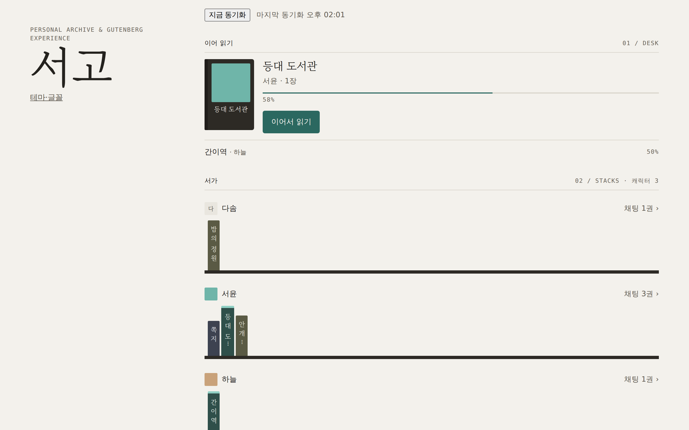
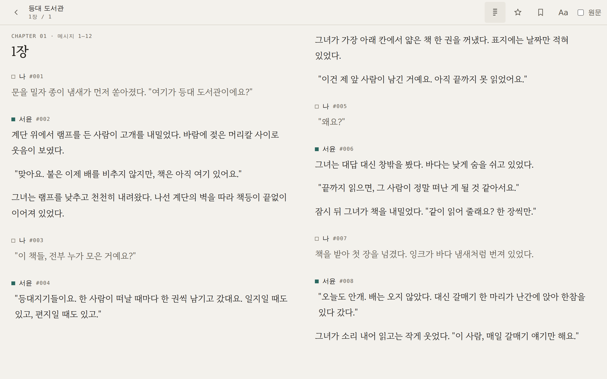
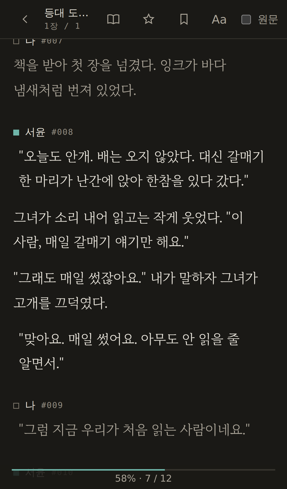
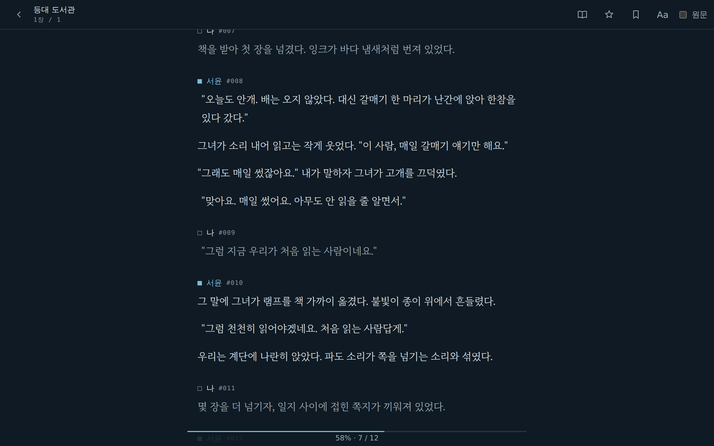
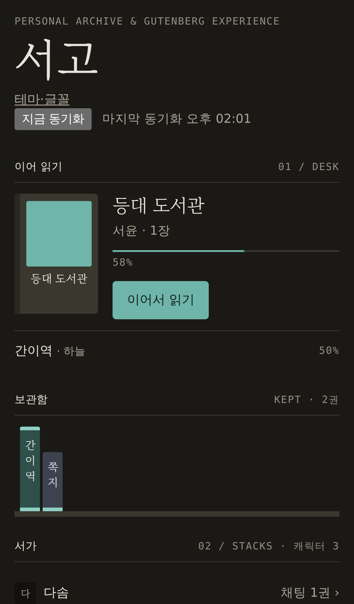
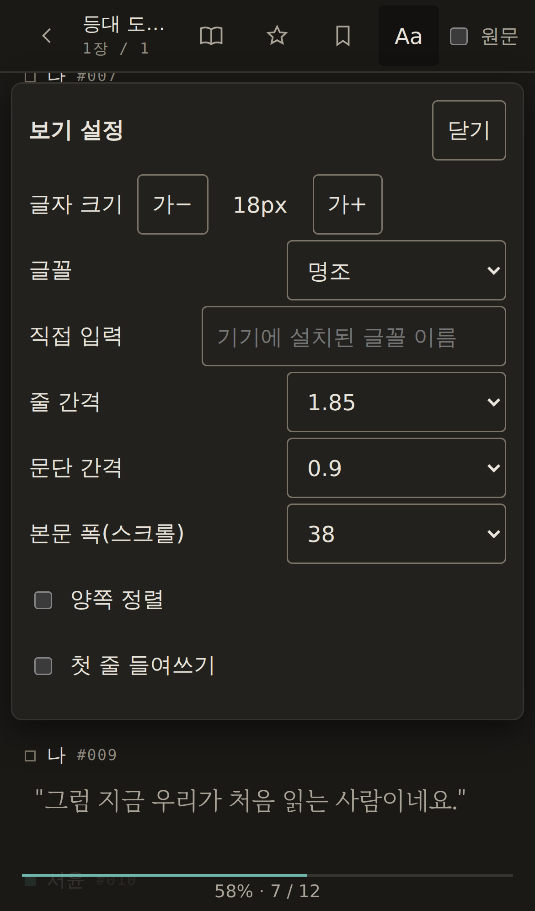

<div align="center">

# P A G E

**Personal Archive & Gutenberg Experience**

PocketRisu 의 채팅을 웹소설처럼, 전자책처럼 읽는 읽기 전용 서고.

*A read-only reader & archive that turns your PocketRisu chats into something you can sit down and read. (Korean UI)*

[](LICENSE)


</div>

> [!WARNING]
> **PAGE 에는 로그인이 없어요.** 서고를 열 수 있는 사람은 누구나 채팅을 전부 읽을 수 있어요.
> 내 컴퓨터, 또는 Tailscale·집 LAN 처럼 **나만 들어오는 네트워크 안에서만** 여세요. 인터넷에 그대로 열지 마세요.
> save 폴더는 읽기 전용으로만 붙어요(PAGE 는 save 에 쓰지 않아요).

<div align="center">



</div>

---

## 무엇인가요

PAGE 는 [PocketRisu](https://github.com/PocketRisu/PocketRisu) 의 save(SQLite)를 **읽기 전용으로** 열어, 쌓아 둔 채팅을 한 권의 책처럼 보여주는 작은 웹앱이에요. 대화하던 화면에서는 잘 안 보이던 이야기를, 스크롤로 내려 읽거나 책장을 넘기듯 읽을 수 있어요.

동시에 **개인 서고**이기도 해요. 원본 save 가 수정되거나 지워져도, PAGE 는 읽어 둔 사본과 이전 버전을 따로 보관해요.

<table>
  <tr>
    <td width="62%"></td>
    <td></td>
  </tr>
  <tr>
    <td align="center"><sub>책처럼 넘기기 · 두 쪽 펼침</sub></td>
    <td align="center"><sub>폰 · 다크 테마</sub></td>
  </tr>
  <tr>
    <td></td>
    <td></td>
  </tr>
  <tr>
    <td align="center"><sub>내가 만든 테마로 읽기</sub></td>
    <td align="center"><sub>폰 · 서고</sub></td>
  </tr>
</table>

## 기능

- **서고** — 이어 읽기 책상, 캐릭터별 서가와 책등(분량만큼 높이, 읽는 중이면 띠), 캐릭터 대표 이미지, 보관함.
- **두 가지 읽기 방식** — 웹소설처럼 세로 스크롤, 또는 책처럼 쪽 넘기기(넓은 화면은 두 쪽 펼침, 키보드·탭·스와이프).
- **읽던 자리 기억** — 위치를 쪽 번호가 아니라 *메시지·문단·글자* 단위로 저장해요. 글꼴·크기·모드를 바꿔도, 다른 기기에서 열어도 같은 자리로.
- **책갈피 · 형광펜** — 문장을 골라 칠하고, 원하는 곳으로 바로 이동. 칠한 문장은 채팅별로, 또는 서고 전체에서 모아 볼 수 있어요.
- **타이포그래피와 테마** — 명조(MaruBuri)·고딕, 크기·줄 간격·문단 간격·폭·양쪽 정렬, 밝게·어둡게·세피아, 말풍선 보기. **CSS 로 직접 만드는 테마**(파일로 주고받기)와 **글꼴 올리기**(woff2·ttf·otf — 아이폰에서도 원하는 글꼴로).
- **나만의 서고로** — 캐릭터·채팅 이름을 PAGE 안에서만 바꾸기, 상태창 같은 조각을 정규식으로 숨기기(캐릭터 카드의 표시용 정규식을 후보로 제안), 내 메시지 숨기고 이야기만 읽기, 카드 정규식의 본문 그림 표시(표정·삽화 — 조건부 그림과 상태창 꾸밈 제외).
- **보존** — 텍스트와 채팅이 참조하는 이미지를 중복 없이 복사. 원본이 바뀌면 버전으로, 지워지면 "원본에서 지워짐" 으로 남겨요 — RisuAI 에서 지운 채팅도 그대로 읽을 수 있어요. 새 채팅은 알아서 따라오고, 바로 반영하고 싶으면 서고의 **지금 동기화**.
- **내보내기** — EPUB(애플 북스·킨들 등, 그림·정규식 포함 여부와 그림 크기 선택), PDF(A5, 쪽 번호·책갈피), RisuAI 로 다시 가져오는 JSON.



## 안전 원칙

PAGE 는 남의 집에 들어가 책만 읽고 나오는 손님처럼 동작해요.

- **save 에 절대 쓰지 않아요.** SQLite 를 `mode=ro` 로 열고, 컨테이너에는 `:ro` 로만 붙여요.
- **PocketRisu 에 로그인하지 않아요.** HTTP API 를 쓰지 않고 파일만 읽어요(쓰던 세션을 밀어내지 않게).
- **로그에 내용을 남기지 않아요.** 요청 본문·채팅 내용·이름은 기록하지 않아요.
- **신뢰하지 않는 원문은 HTML 로 넣지 않아요.** 메시지는 비활성 문서에서 파싱해 허용된 블록만 그리고, 엄격한 CSP(`default-src 'self'`)로 제공해요.
- **로그인이 없어요.** 접근 보호는 네트워크에 맡겨요 — 위 경고를 꼭 지켜 주세요.

<br clear="right">

## 설치

필요한 것: Docker(Compose), 그리고 PocketRisu 의 save 폴더(`risuai.db` 가 있는 곳). 이미지는 amd64·arm64(애플 실리콘 Mac·라즈베리파이(64비트 OS) 등) 둘 다 있어요.

> **Windows · Mac** 에서도 [Docker Desktop](https://www.docker.com/products/docker-desktop/) 으로 돌아갈 거예요(직접 확인은 Linux 에서 했어요). 경로는 `.env` 에 그 컴퓨터의 경로로 적으면 돼요(예: Windows `C:/Users/me/pocketrisu/save`). 아래 `sudo chown` 줄은 Linux 에서만 필요해요.

```bash
git clone https://github.com/Sallos725/PAGE.git && cd PAGE
cp .env.example .env    # PAGE_SAVE_DIR 를 내 save 경로로
mkdir -p ./page-data && sudo chown 1000:1000 ./page-data   # 데이터 폴더는 uid 1000 이 쓸 수 있어야 해요
docker compose up -d
```

save 폴더는 uid 1000 이 읽을 수 있어야 해요(Linux: 필요하면 `chmod -R a+rX <save 폴더>`).

그다음 `http://127.0.0.1:6008` 을 열면 돼요. 처음 열면 save 를 읽어 서고를 채워요(백그라운드).

PDF 내보내기는 같이 올라오는 `page-pdf` 컨테이너(헤드리스 Chromium, 호스트 포트·외부 통신 없음)가 만들어요. 이미지가 약 900MB 예요. PDF 가 필요 없으면 `docker-compose.yml` 에서 `page-pdf` 서비스, `page` 의 `depends_on`·`pdf` 네트워크·`PAGE_PDF_URL`, 맨 아래 `networks.pdf` 를 지우면 돼요.

### 설정 (`.env`)

| 변수 | 설명 |
|---|---|
| `PAGE_SAVE_DIR` | 읽을 save 폴더. 컨테이너에는 읽기 전용으로 붙어요. |
| `PAGE_DATA_HOST_DIR` | PAGE 데이터(서고 사본·읽기 상태·테마·글꼴, 기본 `./page-data`). uid 1000 이 쓸 수 있어야 해요. |
| `PAGE_HOST_PORT` | 호스트 포트 (기본 6008). |
| `PAGE_HOST_BIND` | 여는 주소 (기본 `127.0.0.1` — 이 컴퓨터에서만). |
| `PAGE_VERSION` | 이미지 버전 (기본 1.0.0). |
| `TZ` | 시간대 (기본 Asia/Seoul). |

컨테이너 안 서버 설정(동기화 주기, 용량 경고 등)은 `PAGE_*` 환경 변수로 바꿀 수 있어요 — [`server/src/config.ts`](server/src/config.ts).

### 다른 기기(폰 등)에서 열기

`PAGE_HOST_BIND` 에 **내 네트워크 안의 주소**를 넣어요 — 예를 들어 이 컴퓨터의 Tailscale 주소(`100.x.y.z`)나 집 LAN 주소(`192.168.x.y`). `0.0.0.0`(모든 주소)은 쓰지 마세요. 공유기 포트 포워딩도 하지 마세요.

HTTPS 가 필요하면 리버스 프록시(예: Nginx Proxy Manager, Caddy)를 앞에 두되, 그 도메인도 사설망(Tailscale 등) 안에서만 열리게 하세요.

### 업데이트 · 백업

```bash
git pull                 # 새 docker-compose.yml·.env.example 받기
# .env 의 PAGE_VERSION 을 새 버전으로 바꾼 뒤
docker compose pull && docker compose up -d
```

백업은 `PAGE_DATA_HOST_DIR` 폴더만 챙기면 돼요. 채팅 사본이 들어 있으니 백업도 암호화해서 보관하는 걸 권해요.

## 소스에서 빌드 · 개발

```bash
# 이미지 대신 직접 빌드
docker compose -f docker-compose.yml -f docker-compose.build.yml up -d --build

# 서버 (Node 24, node:sqlite, Fastify)
cd server && npm ci && npm test && npm run build

# 웹 (Svelte 5, Vite)
cd web && npm ci && npm test && npm run check && npm run build

# E2E (Playwright, 합성 save 로 실제 서버를 띄운다)
cd web && npm run e2e                     # chromium
scripts/e2e-webkit-docker.sh              # webkit — 호스트 라이브러리 없이 Playwright 이미지에서

# 이미지 스모크 (합성 save)
scripts/deploy-smoke.sh

# 스크린샷 다시 찍기 (직접 지은 데모 이야기)
node scripts/demo/screenshots.mjs
```

테스트 픽스처와 데모는 모두 **합성 데이터**예요. 실제 채팅은 저장소 어디에도 들어가지 않아요.

## 문제 · 질문

이슈로 남겨 주세요. 개인 프로젝트라 답이 느릴 수 있어요.

## 크레딧

- save 해독 코드는 [PocketRisu](https://github.com/PocketRisu/PocketRisu) (GPL-3.0, [RisuAI](https://github.com/kwaroran/Risuai) 기반)에서 가져왔어요 — [`NOTICE.md`](NOTICE.md).
- 본문 글꼴 [마루 부리](https://hangeul.naver.com/fonts/search?f=maru) © NAVER Corp., SIL Open Font License 1.1.
- PAGE 는 PocketRisu·RisuAI 와 공식적인 관계가 없는 개인 프로젝트예요.

## 라이선스

[GPL-3.0](LICENSE). 포함된 서드파티 구성 요소와 각자의 라이선스는 [`NOTICE.md`](NOTICE.md) 에 있어요.
